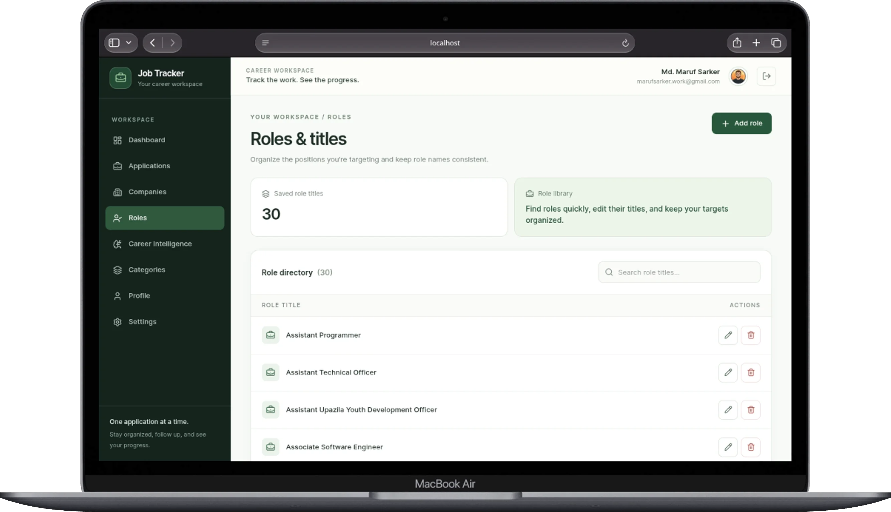

# JobTracker

A modern, self-hosted job application and interview management platform built with ASP.NET Core 10 and React 19.

[](https://github.com/maruf-pfc/job-tracker/actions/workflows/backend-ci.yml)
[](https://github.com/maruf-pfc/job-tracker/actions/workflows/frontend-ci.yml)
[](https://github.com/maruf-pfc/job-tracker/actions/workflows/docker-ci.yml)
[](https://github.com/maruf-pfc/job-tracker/actions/workflows/codeql.yml)
[](LICENSE)
[](https://dotnet.microsoft.com/)
[](https://react.dev/)

Live Demo: [job-trackerr.vercel.app](https://job-trackerr.vercel.app)

---

## Overview

JobTracker helps developers and job seekers organize their recruitment pipelines, log interview rounds, analyze rejection root causes, and monitor application health. It includes dedicated workflows for both corporate software engineering roles and competitive government or bank examinations.

---

## Screenshots

### Dashboard & Analytics


### Applications Management


### Companies Directory & Red Flag Alerts


### Roles & Categories
| Target Job Roles | Taxonomy & Categories |
| :---: | :---: |
|  |  |

### Profile & Settings
| User Profile | Settings & Webhooks |
| :---: | :---: |
|  |  |

### Webhook Notifications
| Telegram Alerts | Discord Integration |
| :---: | :---: |
|  |  |

---

## Features

### Pipeline & Application Management
- Track applications with status, priority, compensation, circular URLs, and deadlines.
- Responsive table with proportional column clamping so all 8 columns fit comfortably on laptop and desktop displays.
- Collapsible navigation rail (`244px` expanded or `72px` compact) with `⌘B` / `Ctrl+B` toggle, persisted across sessions.
- Dedicated mobile card view for small screen viewports.

### Multi-Round Interview Tracking
- Log individual interview rounds across technical stages (Coding, System Design, Behavioral) or public sector stages (Preliminary, Written Exam, Viva).
- Real-time passed round counters and stage drop-off indicators (`3 rounds passed • Dropped at System Design`).
- Interactive timeline modal to record round dates, notes, and results.

### Company Directory & Fake Job Warnings
- Directory to manage target employers, official websites, and careers portals.
- One-click favorite starring to highlight priority targets.
- Red flag tagging for suspected fake or problematic job postings. Selecting a flagged company in the application form immediately displays a caution banner with previous notes.

### Rejection Post-Mortems
- Structured retrospective survey capturing difficulty ratings, time management, topic gaps, and confidence indices.
- Aggregates recurring weaknesses (e.g. Dynamic Programming, Concurrency, SQL Optimization) to guide future preparation.

### AI Strategic Advisor (Optional)
- Google Gemini integration generating personalized pipeline assessments and weekly action plans.
- SHA-256 state-hash caching: avoids duplicate API calls when application data has not changed.

### Webhook Automation
- Real-time notifications dispatched to Discord channels and Telegram bots when applications are created or updated.

### Multi-Tenant Data Isolation
- Strict account-level isolation for applications, custom roles, and companies via authenticated user IDs.
- ASP.NET Core Identity with JWT bearer authentication and refresh token rotation.

---

## Architecture & Tech Stack

```
job-tracker/
├── client/                     # React 19 Frontend (Vite, TypeScript, TailwindCSS)
│   ├── src/
│   │   ├── components/         # Modular UI, modals, tables, and forms
│   │   ├── hooks/              # Custom TanStack Query hooks
│   │   ├── pages/              # Application views and routes
│   │   ├── services/           # Typed Axios API clients
│   │   └── stores/             # Zustand state stores
├── server/                     # ASP.NET Core 10 Web API
│   ├── JobTracker.API/         # Controllers, services, EF Core configurations
│   └── JobTracker.API.Tests/   # Unit tests (xUnit, Moq, EF Core InMemory)
└── docs/                       # Technical specifications and deployment guides
```

### Technology Matrix

| Layer | Technologies |
| :--- | :--- |
| **Frontend** | React 19, TypeScript, Vite, Tailwind CSS, TanStack Query v5, Zustand, Recharts, Lucide Icons |
| **Backend** | ASP.NET Core 10 Web API, Entity Framework Core 10, ASP.NET Core Identity |
| **Database** | PostgreSQL (supported on local instances, Docker, or Neon Cloud) |
| **AI Integration** | Google Gemini API (`gemini-2.5-flash`) with client-side SHA-256 hash validation |
| **Testing** | xUnit, Moq (50 backend tests), Vitest, React Testing Library (31 frontend tests) |

---

## Getting Started

### Prerequisites
- [.NET 10.0 SDK](https://dotnet.microsoft.com/download/dotnet/10.0)
- [Node.js](https://nodejs.org/) (`>= 20.0`) or [Bun](https://bun.sh/) (`>= 1.1`)
- [PostgreSQL](https://www.postgresql.org/) (or use Docker / Neon Cloud)
- Google Gemini API Key *(Optional, required only for AI Advisor recommendations)*

---

### Local Setup

#### 1. Clone Repository & Environment Configuration
```bash
git clone https://github.com/maruf-pfc/job-tracker.git
cd job-tracker
cp .env.example .env
```

#### 2. Run Backend
```bash
cd server/JobTracker.API
dotnet restore
dotnet run
```
- API will be accessible at: `http://localhost:5104`
- Swagger UI documentation: `http://localhost:5104/swagger`
- Pending Entity Framework migrations are automatically applied on startup.

#### 3. Run Frontend
```bash
cd client
bun install
bun run dev
```
- Client application will be running at: `http://localhost:5173`

---

## Testing & Quality Assurance

### Run Backend Unit Tests (50 passing)
```bash
dotnet test server/JobTracker.API.Tests
```

### Run Frontend Unit Tests (31 passing)
```bash
cd client
bun run test
```

### Type Checking & Linting
```bash
cd client
bun run lint
bun run build
```

---

## Docker Deployment

### Run Pre-Built Image from Docker Hub
```bash
docker pull marufsarker/job-tracker:v1.0.0

docker run -d \
  -p 8080:8080 \
  --name job-tracker \
  -e DATABASE_URL="Host=your_host;Database=jobtracker_db;Username=postgres;Password=your_password;" \
  -e JWT_KEY="your-secure-32-plus-characters-secret-key" \
  marufsarker/job-tracker:v1.0.0
```
Web application will be accessible at `http://localhost:8080`.

### Run Multi-Container Stack (Docker Compose)
```bash
docker compose up --build -d
```
- Frontend: `http://localhost:3000`
- Backend API: `http://localhost:5104`
- Local PostgreSQL: `localhost:5432`

---

## Documentation

- [System Architecture](docs/architecture.md)
- [Database Schema & ERD](docs/database_schema.md)
- [REST API Reference](docs/api_documentation.md)
- [Refactoring & Hardening Report](docs/refactoring-report.md)
- [Deployment & Webhooks Setup](docs/deployment_and_webhooks.md)
- [Coolify Self-Hosting Guide](docs/coolify_deployment.md)

---

## License

This project is licensed under the [MIT License](LICENSE).
