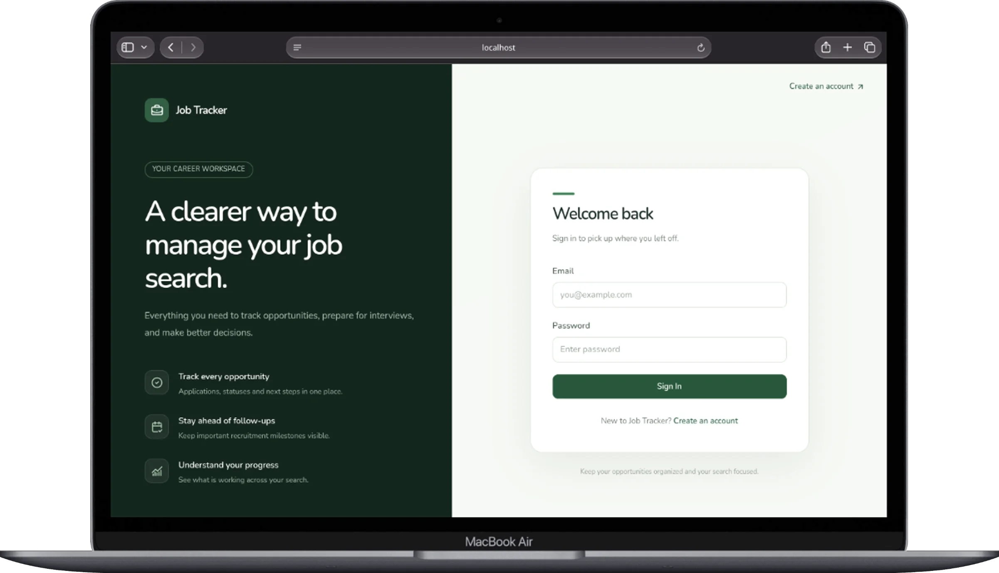
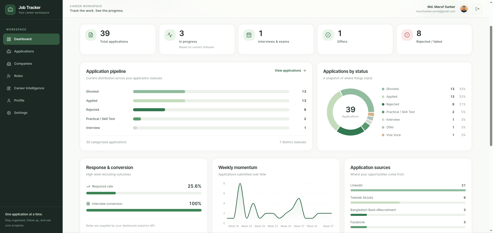
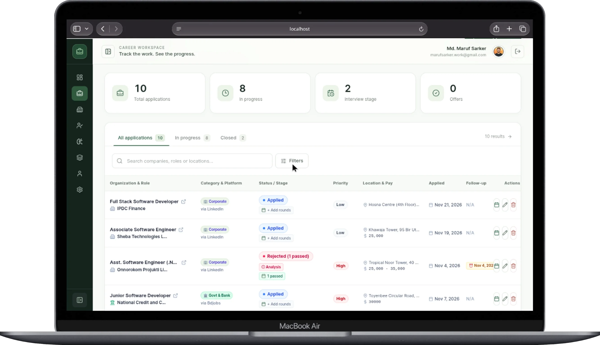
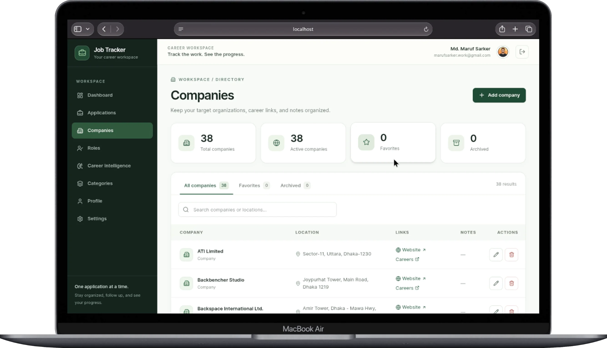
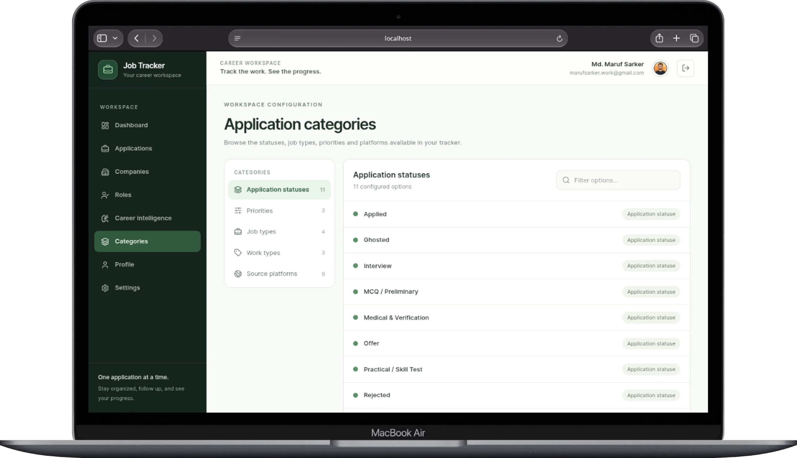
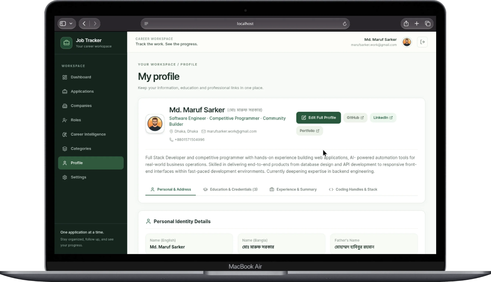
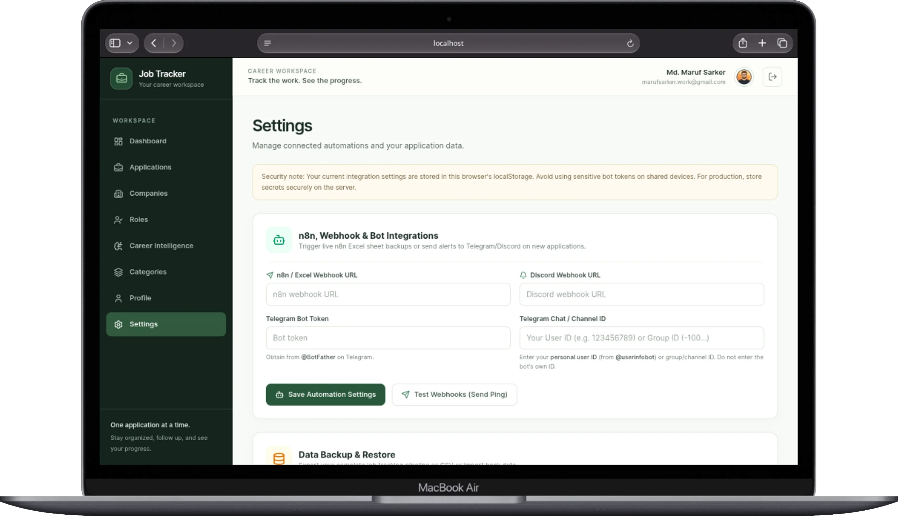

# 💼 JobTracker - Open-Source Career Operations & Failure Analytics OS

[](https://github.com/maruf-pfc/job-tracker/actions/workflows/backend-ci.yml)
[](https://github.com/maruf-pfc/job-tracker/actions/workflows/frontend-ci.yml)
[](https://github.com/maruf-pfc/job-tracker/actions/workflows/docker-ci.yml)
[](https://github.com/maruf-pfc/job-tracker/actions/workflows/codeql.yml)
[](LICENSE)
[](https://dotnet.microsoft.com/)
[](https://react.dev/)
[](https://tailwindcss.com/)
[](https://job-trackerr.vercel.app)

An enterprise-grade, open-source **Career Operations OS and Recruitment Intelligence Engine** built for modern tech professionals and government/bank candidates. Features comprehensive pipeline management, multi-round interview tracking, failure post-mortems, full account isolation, and an **AI Strategic Career Advisor** with intelligent SHA-256 state caching.

🌐 **Live Production App**: [https://job-trackerr.vercel.app](https://job-trackerr.vercel.app)

---

## 🌟 Key Highlights & Comprehensive Features

### 1. 🤖 AI Strategic Career Advisor (Gemini Flash + SHA-256 State Caching)
- **Executive Diagnostics**: High-level synthesis of your pipeline momentum, interview conversion velocity, and drop-off bottlenecks.
- **Dual-Track Govt vs. Corporate Strategy**: Tailored guidance distinguishing Bangladesh Govt/Bank recruitment exams (BPSC, Combined Bank) and Corporate Software Engineering interviews.
- **Tactical Strengths & Critical Gaps**: Actionable SWOT-style insights identifying technical weak spots and interview stage roadblocks.
- **Prioritized Weekly Action Plan**: Concrete, categorized weekly deliverables prioritized by urgency and impact.
- **⚡ SHA-256 State-Hash Caching**: If no application or retrospective data has changed, cached recommendations are served in milliseconds with **zero redundant AI calls**. Invalidation triggers automatically upon new activity.

### 2. 🚩 Company Favorites & Fake Job Red Flag Warnings
- **One-Click ⭐ Favorites**: Star target employers directly from the table or directory to prioritize high-intent opportunities.
- **🚩 Red Flag Alert System**: Mark suspected fake job postings, ghost listings, or unverified recruiters with custom warning notes.
- **Application Form Caution Banners**: Selecting a red-flagged organization in the application form immediately displays a prominent caution alert explaining previous red flags.
- **Dedicated Directory Filters**: Instantly slice target organizations by **All Companies**, **⭐ Favorites**, **🚩 Red Flags**, or **Archived**.

### 3. ⏱️ Granular Multi-Round Interview Timeline
- **Full Stage Coverage**: Track progress across Preliminary MCQ, Written Exam, Coding Assessment, System Design, Behavioral, and Viva stages.
- **Real-Time Stage Metrics**: Live counters for passed rounds and stage drop-offs (e.g. `3 rounds passed • Dropped at System Design`).
- **Interview Modal Timeline**: Record round-by-round dates, results (`Passed`, `Failed`, `Pending`, `Cancelled`), and preparation notes.
- **Unified Pipeline Sync**: Updates synchronize seamlessly between the Applications board, Dashboard KPI cards, and AI diagnostic models.

### 4. 🔬 Google-Form Failure Retrospective & Remediation Engine
- **10-Step Comprehensive Survey**: Standardized diagnostic survey covering 15+ quantitative metrics across difficulty, preparation time, and confidence indices.
- **Topic Gap Frequency Heatmap**: Pinpoint specific recurring topics (e.g., Dynamic Programming, Concurrency, SQL Optimization) that caused rejections.
- **Environmental Blocker Tracking**: Track systemic hurdles like sleep deprivation, burnout, or time pressure.
- **Prescribed Remediation Roadmaps**: Concrete self-study plans and practice recommendations to prepare for future rounds.

### 5. 💻 Collapsible Navigation & Laptop/MacBook Viewport Optimization
- **Collapsible Sidebar Rail**: One-click toggle (and `⌘B` / `Ctrl+B` keyboard shortcut) switching between full sidebar (`244px`) and compact icon rail (`72px`), auto-persisted in `localStorage`.
- **Proportional Table Sizing**: Proportional column constraints and text clamping that fit all 8 application columns cleanly on 13"/14" laptop screens with zero cutoff.
- **Custom Thin Scrollbars**: Smooth macOS-compatible scroll indicators for tablet and split-screen viewports.
- **Mobile & Tablet Cards**: Automatic conversion to clean responsive card layouts on viewports `< md`.

### 6. 🗂️ Centralized Lookup Taxonomy & Category Management
- **Category Customization**: Manage recruitment Work Types (Remote, Onsite, Hybrid), Job Types (Corporate Tech, Govt, Bank), and Source Platforms (LinkedIn, Bdjobs, Teletalk, eRecruiter, Company Portal).
- **Target Roles Directory**: Catalog and track customized software engineering roles and civil service cadremanship titles.

### 7. 🔔 Live Notifications & Real-Time Alert Webhooks
- **Multi-Channel Integrations**: Instant webhook notifications to **Telegram** (via Bot API) and **Discord** (via Webhooks).
- **Automated Dispatches**: Receive rich Markdown alerts on new job applications, recruitment status changes, and interview results.

### 8. 🔒 Enterprise-Grade Multi-Tenant Isolation & Security
- **Strict Data Isolation**: User-created companies, custom job roles, circulars, applications, and retrospectives are partitioned strictly by the authenticated `UserId`.
- **Global Shared Templates**: Seeded standard corporate roles and government circular entities available across accounts.
- **Hardened Authentication**: ASP.NET Core Identity with JWT bearer tokens, refresh token rotation, and rate-limiting.

### 9. 📊 Real-Time Pipeline Analytics & Interactive Funnel
- 6 Key Performance Indicator (KPI) metrics cards.
- Conversion velocity funnel with drop-off analytics.
- Recharts visualizations: Weekly Application Velocity, Pipeline Status Donut, Application Portals Breakdown, and Target Role Priorities.
- Graceful empty states with zero dummy placeholders for new accounts.

---

## 📸 UI Showcase & Architecture

### 1. Secure Authentication & Onboarding


### 2. Analytics Dashboard & AI Career Strategist


### 3. Applications Workspace with Responsive Clamping & Filters


### 4. Target Companies Management (Favorites & Red Flag Alerts)


### 5. Target Job Roles & Career Titles


### 6. Lookup Categories Engine (Work Types, Job Types, Platforms)


### 7. User Profile & Competitive Programming Credentials


### 8. Integrations, Webhooks & Diagnostics Settings


### 9. Telegram Bot Automation & Live Alerts


### 10. Discord Webhook Channel Notifications


---

## ⚡ Tech Stack Architecture

### Frontend (Client)
- **Core Framework**: React 19 + TypeScript + Vite 8
- **Styling & Motion**: TailwindCSS v4, Framer Motion (`framer-motion`), Lenis Smooth Scroll, Lucide Icons
- **State & Data**: React Query (TanStack Query v5), Zustand, Axios
- **Visualization**: Recharts Data Visualization Suite
- **Tooling & Test Runner**: Vitest, React Testing Library, ESLint

### Backend (Server)
- **Core Framework**: ASP.NET Core 10.0 Web API
- **AI Engine**: Google Gemini API (`gemini-2.5-flash`) with SHA-256 data signature caching
- **Database & ORM**: PostgreSQL (Local / Neon Cloud) via Entity Framework Core 10
- **Security & Auth**: ASP.NET Core Identity, JWT Bearer Tokens, Rate Limiting, Security Headers
- **Testing**: xUnit, Moq, EF Core InMemory Provider (50 unit tests)

---

## 🚀 Quickstart & Local Setup Guide

### Prerequisites
- [.NET 10.0 SDK](https://dotnet.microsoft.com/download/dotnet/10.0)
- [Node.js](https://nodejs.org/) (`>= 20.0`) or [Bun](https://bun.sh/) (`>= 1.1`)
- [PostgreSQL](https://www.postgresql.org/) (or use Docker / Neon Cloud)
- Google Gemini API Key (Optional for AI Advisor)

---

### Step 1: Clone Repository & Configure Environment
```bash
git clone https://github.com/maruf-pfc/job-tracker.git
cd job-tracker
cp .env.example .env
```
Edit `.env` to configure your `DATABASE_URL`, `JWT_KEY`, and `GEMINI_API_KEY`.

---

### Step 2: Run the Backend Server
```bash
cd server/JobTracker.API
dotnet restore
dotnet run
```
- **Swagger API Docs**: `http://localhost:5104/swagger`
- Entity Framework automatically applies pending migrations on startup!

---

### Step 3: Run the Frontend Client
```bash
cd client
bun install
bun run dev
```
- Open `http://localhost:5173` in your browser!

---

## 🧪 Running Unit Tests

### Backend Unit Tests (50 / 50 Passing)
```bash
dotnet test server/JobTracker.API.Tests
```

### Frontend Unit Tests (31 / 31 Passing across 9 test suites)
```bash
cd client
bun run test
```

### Production Build & Lint Verification
```bash
cd client
bun run lint
bun run build
```

---

## 🐳 Docker & Docker Hub Setup

### 📦 Pull & Run from Docker Hub
The unified full-stack image (React Client + .NET 10 Web API) is available on Docker Hub:
**[hub.docker.com/r/marufsarker/job-tracker](https://hub.docker.com/r/marufsarker/job-tracker)**

```bash
# Pull the latest v0.1.0 full-stack image
docker pull marufsarker/job-tracker:v0.1.0

# Run container with your PostgreSQL database
docker run -d \
  -p 8080:8080 \
  --name job-tracker \
  -e DATABASE_URL="Host=your_postgres_host;Database=jobtracker_db;Username=postgres;Password=your_password;" \
  -e JWT_KEY="your-secure-32-plus-characters-secret-key" \
  marufsarker/job-tracker:v0.1.0
```
- Access full web app at `http://localhost:8080`

---

### 🐳 Docker Compose (Multi-Container)
Run the full production stack with local PostgreSQL using Docker Compose:
```bash
docker compose up --build -d
```
- **Frontend Web App**: `http://localhost:3000`
- **Backend Web API**: `http://localhost:5104`
- **PostgreSQL Database**: `localhost:5432`

---

## 📚 Technical Documentation

- 🏗 **[System Architecture & Design](docs/architecture.md)**: Clean architecture, AI caching subsystem, multi-tenant isolation.
- 🛡 **[Refactoring & Hardening Report](docs/refactoring-report.md)**: Senior audit findings, SSRF mitigation, exception taxonomy, and test expansion report.
- 🗄 **[Database Model & Schema](docs/database_schema.md)**: PostgreSQL ER Diagram, table constraints, indices, and UTC timestamp mappings.
- 🔌 **[REST API Specifications](docs/api_documentation.md)**: Endpoints reference, AI Advisor endpoints, request/response DTO schemas.
- 🛠 **[Troubleshooting & Bug Fixes](docs/troubleshooting_and_bugfixes.md)**: Resolution log (React hook ordering, state caching, user isolation).
- 🚀 **[Deployment & Webhooks Guide](docs/deployment_and_webhooks.md)**: Docker Compose orchestration, Vercel monorepo settings, n8n integrations.
- ⚡ **[Coolify Deployment Guide](docs/coolify_deployment.md)**: Self-hosting setup on Coolify v4.

---

## 📄 License

This project is licensed under the [MIT License](LICENSE).
